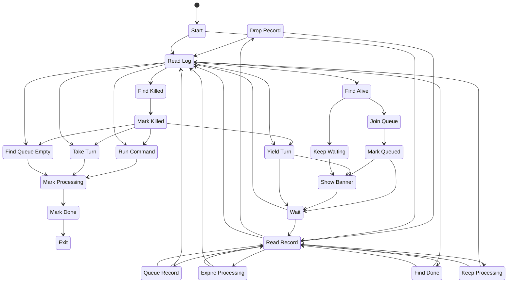

# Banan: a simple job queuer

[](https://pkg.go.dev/github.com/pietv/banan)

**Banan** ([Basque](https://translate.google.com/?sl=eu&tl=en&text=banan&op=translate): *"one by one"*, *"separately"*)
is a simple job queuer that runs a given shell command strictly in
sequence, one instance at a time. A command is identified by the name of its
binary (arguments are ignored), so all runs of the same-named command
run through this tool are serialized through a shared log file. Commands
with the same name may run simultaneously if `banan` is invoked with
different `--log-dir` directories.

It was originally written to queue build jobs arriving at a build server
over SSH at random times. Each job cloned a GitHub repository,
pulled upstream dependencies, and ran configuration tweaks: a sequence
that is unsuitable to be run in parallel.

## Install

Requires Go version ≥ `1.21.7`.

```bash
$ go install github.com/pietv/banan@latest
```

## Execution

**Banan** executes the command right away or waits for another instance of that
command to complete (if that command has been run using **banan**).
The command is identified by the name of the executable (for example:
for a command line `bash -c echo 123` the identification name is `bash`).

**Banan** consults the log to check if other instances are being run at the moment.
The name of the log file is the name of the executable minus the file extension.
When the log is written, it is locked using the operating system's file locking
mechanisms.

By default, the log file is created in the current directory; that can be overridden
with the `--log-dir` flag.

```bash
$ banan -- bash -c echo running; sleep 2&
$ banan -- bash -c echo running; sleep 2&
$ banan -- bash -c echo running; sleep 2
```

```bash
$ cat bash.log
```

```json
{"time":"2024-Apr-09 12:12:56 UTC","state":"Processing","pid":45772}
{"time":"2024-Apr-09 12:12:56 UTC","state":"Done","pid":45772,"wall_clock_time":"2.00s"}
{"time":"2024-Apr-09 12:12:56 UTC","state":"Processing","pid":45781}
{"time":"2024-Apr-09 12:12:56 UTC","state":"Done","pid":45781,"wall_clock_time":"2.00s"}
{"time":"2024-Apr-09 12:12:56 UTC","state":"Processing","pid":45790}
{"time":"2024-Apr-09 12:12:56 UTC","state":"Done","pid":45790,"wall_clock_time":"2.00s"}
```

```bash
Banan - a simple job queuer
Usage: banan [FLAGS...] COMMAND

  Flags:
       --version         Displays the program version string.
    -h --help            Displays help with available flag, subcommand, and positional value parameters.
       --timeout         Period after which the command is considered timed out (default: 30m0s)
       --remind-every    Remind that the command is still waiting to be executed (default: 5s)
       --queued-pickup   Allow the next queued command to start running if previous is slow to pick up (default: 15s)
       --remind-banner   Show this file instead of standard message.
       --log-dir         Directory to create the log file in (default: .)
    -e --environment     Set environment variables.
    -d --debug           Debug operation
       --man             Show the manual page
```

## Example

A real-life example of running an Android build on an ad-hoc builder server:

```bash
$ banan -e BUNDLE_ID=$BUNDLE_ID \
        -e VERSION=$VERSION \
        -e BUILD_NUMBER=$BUILD_NUMBER \
        -e BUILDER_GITHUB_USER=$BUILDER_GITHUB_USER \
        -e BUILDER_GITHUB_TOKEN=$BUILDER_GITHUB_TOKEN \
        -e CIRCLE_BRANCH=$CIRCLE_BRANCH \
        -e CIRCLE_COMMIT=$(git rev-parse HEAD) \
        --remind-every=30s \
        --remind-banner=queued-banner.txt \
        --log-dir=. \
        ./clone-and-build.sh
```

## State diagram

`banan` records the states it goes through in a finite state machine
(`fsm.New(...)`) with allowed transitions set in `New()` in `banan.go`.
The `banan` test cases check against the allowed transitions.



The meaning of the states:

* **Start**, **Wait**: a new pass over the log starts either at the very beginning
  or after waiting for the next check.
* **Read Record** and the states following it (**Find Done**, **Keep Processing**,
  **Expire Processing**, **Queue Record**, **Drop Record**): the log is read record by
  record; each record is classified. A *Processing* record that is older than the
  timeout is expired, a *Queued* record older than the relevance period is dropped.
* **Read Log**: the whole log has been read; time to decide.
* **Find Killed**, **Find Alive**: the process being waited upon has been checked
  and is found not running anymore (**Mark Killed**) or still running.
* **Find Queue Empty**, **Run Command**, **Take Turn**: it is time to proceed
  because nothing is waiting, because it is not yet this instance's turn, or because the
  instance whose turn it was has not picked up in time (`--queued-pickup`).
  **Mark Processing** records that and the command runs.
* **Yield Turn**, **Keep Waiting**, **Join Queue**: it is still not this instance's
  turn; **Join Queue** and **Mark Queued** let others know it is waiting.
* **Show Banner**: remind that the command is still waiting.
* **Mark Done**, **Exit**: the command has completed and its exit
  status is recorded.

## License

This project is licensed under the [MIT License](LICENSE).
